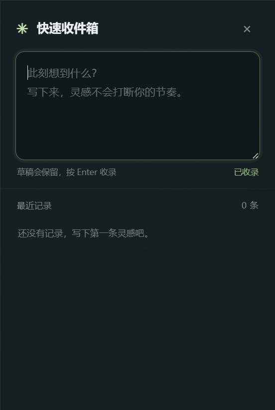
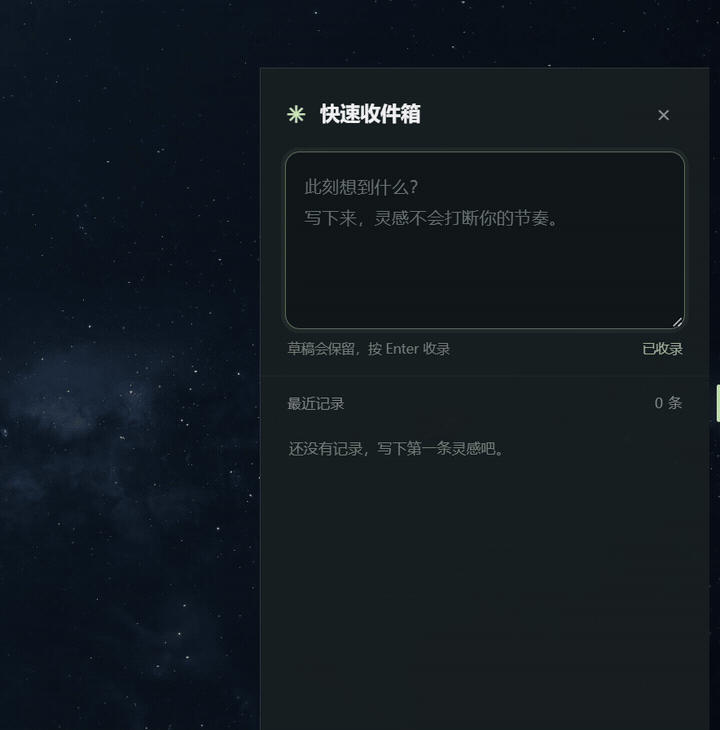

# 隅笺 Nooknote

**贴在屏幕边缘的快速收件箱。** 鼠标移到边缘即可唤出，按 Enter 收好刚想到的灵感或备忘。

> 项目状态：MVP（最小可用版本） · Windows 桌面端 · v1.0.0

隅笺希望让临时记录足够轻：入口平时收在屏幕边缘，不用切换到另一款应用；记下内容后，窗口会在鼠标离开时收起，草稿和已收录的记录仍会保留在本机。

## 演示

### 界面截图



### 操作演示



[打开原始演示视频（MP4）](docs/videos/presentVideo.mp4)

## 为什么做隅笺

专注处理一项任务时，常会突然想到一个与当前工作关系不大的点子。为了不忘记不遗漏这一个好点子，人很容易停下手头的事，打开笔记软件、搜索工具或待办应用；原本只想记下一句话，却可能一路查下去，打断当前的专注。

隅笺把一个临时收件箱放在屏幕边缘。想到什么时，随手记下就能回到正在做的事，不必专门打开记录软件。等这段专注结束后，再统一查看和处理这些想法；事情完成后可以立即删除，让收件箱保持轻量。

## 当前功能

- **边缘唤出**：屏幕边缘保留一条低调的触发线，鼠标悬停后展开快速收件箱。
- **拖动换边**：按住触发线即可移动；拖动时细线会变成随方向摆动的水滴，松开后吸附到最近的屏幕边缘。
- **快速收录**：按 Enter 保存，Shift+Enter 换行；中文输入法选择候选词时不会误提交。
- **草稿保留**：窗口收起或重新唤出时，未保存的内容仍在，光标回到草稿末尾。
- **最近记录**：记录按时间倒序排列，可展开查看全文并删除；时间会区分今天、昨天和更早日期。
- **托盘常驻**：关闭面板只会收起应用；从系统托盘可设置开机启动或完全退出。开机启动默认关闭。
- **本地存储**：草稿、记录和触发位置保存在本机，不需要账号，也不做云同步。

## 网页原型

仓库保留了早期交互原型。用浏览器打开 `index.html` 即可体验；原型数据存放在当前浏览器的 `localStorage` 中，与桌面版数据分开。

## Windows 桌面版

桌面版使用 Tauri 2。界面由 `desktop/` 中的 HTML、CSS 和 JavaScript 构成；Rust 负责窗口、边缘触发、拖动吸附、系统托盘和本地数据。

### 开发环境

- Windows x64
- Node.js 与 npm
- Rust 工具链（Rust 1.90 或更新版本）
- Visual Studio C++ Build Tools

### 本地运行

```powershell
npm install
npm start
```

### 构建安装包

```powershell
npm run dist
```

NSIS 安装包生成在 `src-tauri/target/release/bundle/nsis/`。桌面版使用 Windows WebView2；安装程序可为尚未安装运行时的系统下载 WebView2。当前桌面构建目标为 Windows x64。

## 项目结构

```text
desktop/       桌面端界面与交互
src-tauri/     Tauri 窗口、系统托盘和本地存储实现
index.html     网页交互原型
```

## MVP 范围

当前版本聚焦于快速收件箱的核心闭环：唤出、临时记录、收起后保留、回看和删除。快捷键唤出、分类、搜索、账号和云同步暂不在 MVP 范围内。
